# 麦泡泡 PopMc · 麦当劳食物潮玩盲盒 (Skill 独立包)

<p align="center">
  <a href="https://github.com/M-China/mcd-developer-innovation-challenge">
    
  </a>
  <a href="https://open.mcd.cn/mcp">
    
  </a>
  <a href="https://www.workbuddy.cn">
    
  </a>
  <a href="LICENSE">
    
  </a>
</p>

> **Pop Your Meal · 麦麦开盒**  
> 不知道吃什么的时候，拆一盒。  
> 基于麦当劳中国官方开放平台 MCP 实时在售菜单，把纠结的选餐过程转变为一次有惊喜、能收藏、可下单的泡泡玛特级 3D 潮玩开盒体验。

<p align="center">
  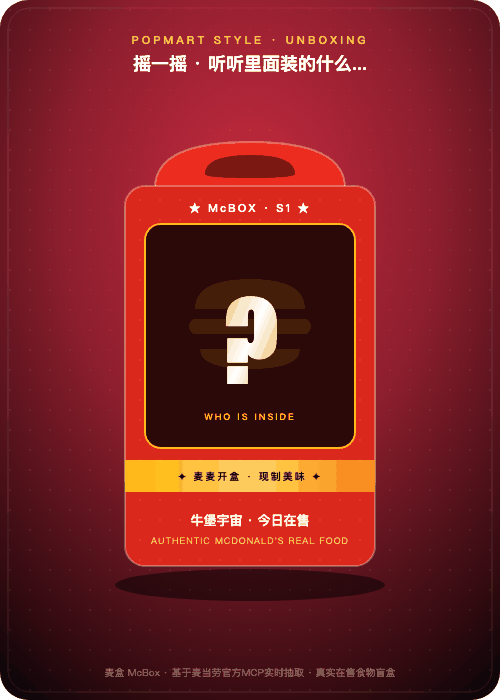
  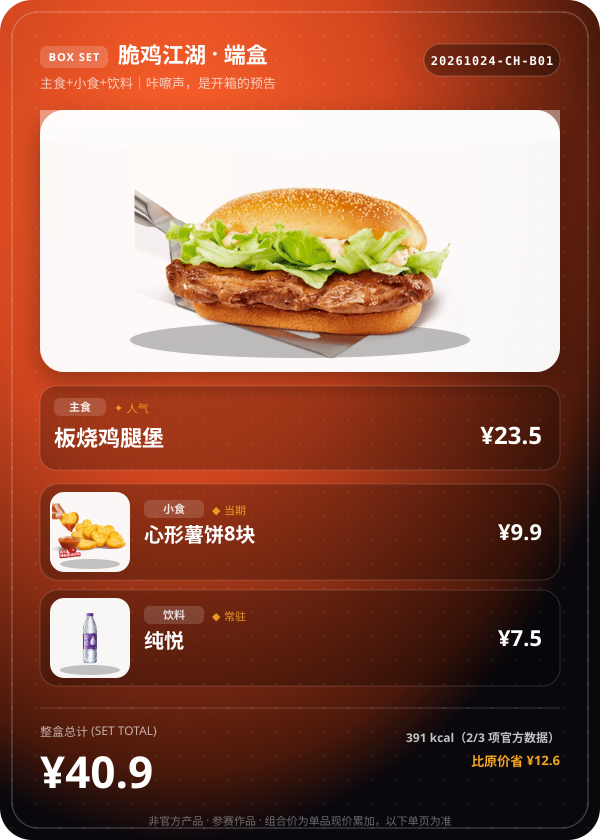
  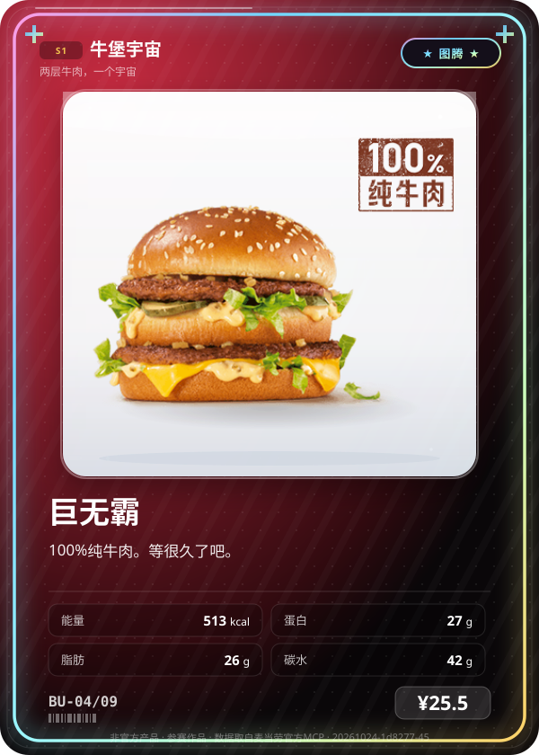
</p>

<p align="center"><sub>左：<b>泡泡玛特级开盒动效（GIF 动态揭晓）</b>｜中：端盒全套展柜卡（主食+小食+饮品）｜右：图腾款全息镭射藏卡</sub></p>

<p align="center">
  <a href="docs/cards-preview.html"><b>🔍 查看 18 款全量卡面大赏</b></a>&nbsp;&nbsp;·&nbsp;&nbsp;
  <a href="docs/unboxing-player.html"><b>🎮 在线体验 3D 沉浸式开盒互动</b></a>&nbsp;&nbsp;·&nbsp;&nbsp;
  <a href="docs/FOOD_CATALOG.md"><b>📋 查看门店全部在售美食清单</b></a>
</p>

---

## 💡 核心价值：它解决什么？

选餐的真正痛点从来不是“缺少选项”，而是**决策疲劳（Choice Overload）**。一家标准麦当劳门店当前在售 130+ SKU，比较热量、价格与口味的心理消耗极高。

**麦泡泡（PopMc）做三件事：**

1. **认知收敛（130+ ➔ 9 大系列）**：把全店复杂的单品折叠为 9 个清晰直观的潮玩心智盲盒，30 秒内解脱纠结；
2. **情绪回报（真实在售 ➔ 潮玩藏卡）**：每一次开盒都伴随**物理摇盒听声、撕开外带封条、彩纸喷发与卡牌 360 度翻转飞升**；抽中的餐品拥有官方实拍原图、营养属性胶囊、防伪条形码与专属风味文案；
3. **真实可买（绝非虚构游戏）**：市面上的随机抽卡多基于静态虚构 JSON，抽出的餐品门店往往无货。麦泡泡全流程直连官方 MCP `query-meals` **实时可售池**——抽中就能买，价格即门店现价，支持安全下单闭环！

---

## 🎨 9 大盲盒系列全景大赏

麦泡泡涵盖全店在售食品单品。每张卡牌均呈现**官方实拍原图 + 3D 悬浮展台 + 属性胶囊 + 防伪条形码**：

<table align="center">
  <tr align="center">
    <td><b>【牛堡宇宙】图腾·巨无霸 (SSR)</b></td>
    <td><b>【脆鸡江湖】当期·龙焰鸡腿堡 (SR)</b></td>
    <td><b>【金黄薯界】图腾·经典大薯条 (SSR)</b></td>
  </tr>
  <tr align="center">
    <td></td>
    <td>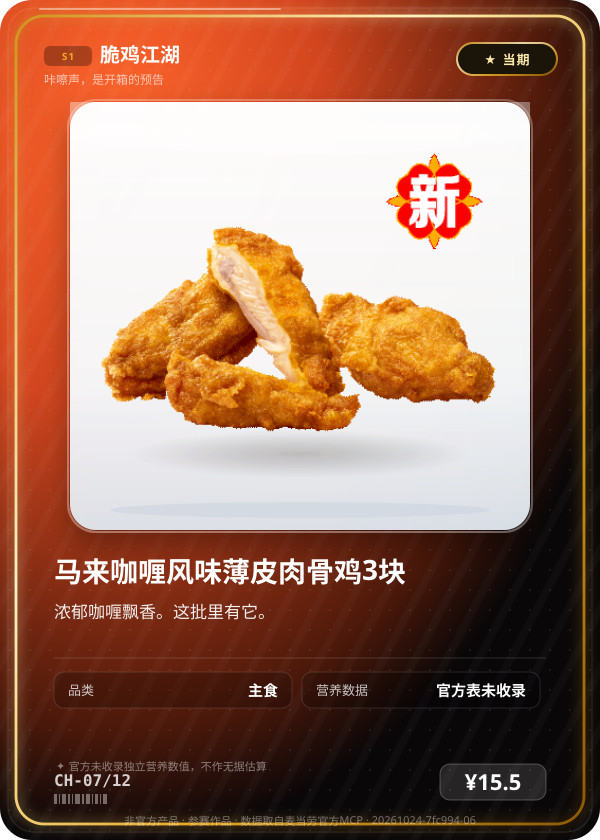</td>
    <td>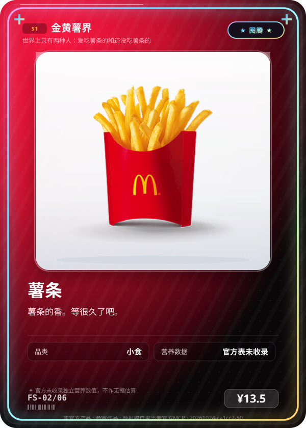</td>
  </tr>
  <tr align="center">
    <td><b>【气泡星海】图腾·麦当劳奶昔 (SSR)</b></td>
    <td><b>【甜品星球】人气·奥利奥麦旋风 (R)</b></td>
    <td><b>【麦咖啡】人气·卡布奇诺 (R)</b></td>
  </tr>
  <tr align="center">
    <td>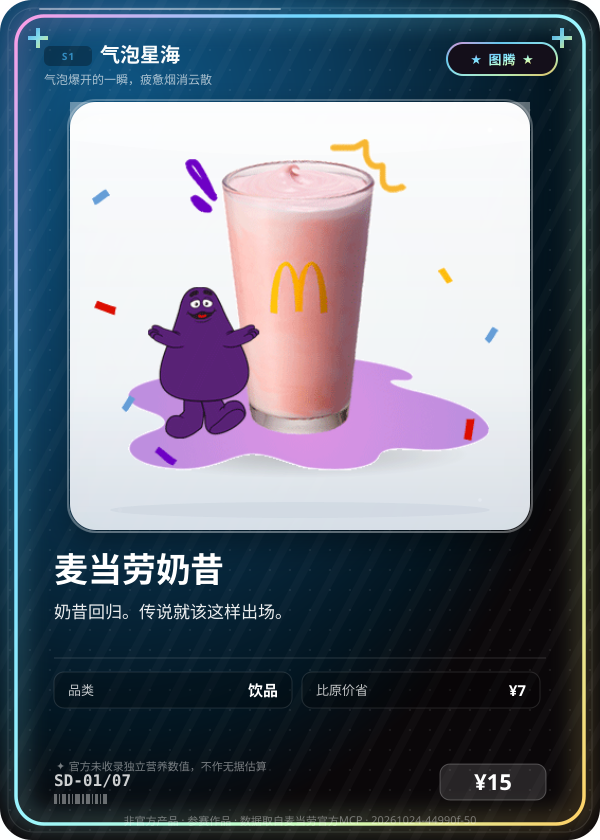</td>
    <td></td>
    <td>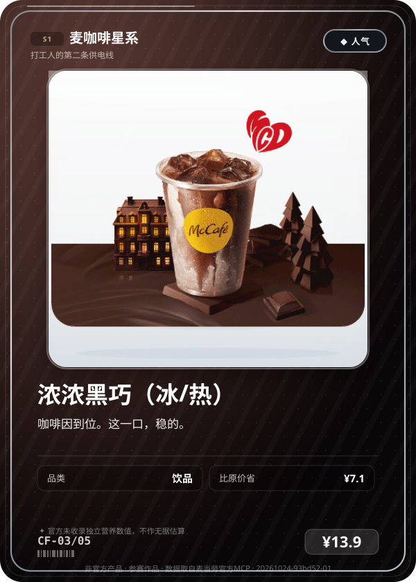</td>
  </tr>
  <tr align="center">
    <td><b>【随心搭子】人气·大堡口福 (R)</b></td>
    <td><b>【分享派对】人气·堡堡随心拼 (R)</b></td>
    <td><b>【未拆盲盒】开心乐园红盒</b></td>
  </tr>
  <tr align="center">
    <td>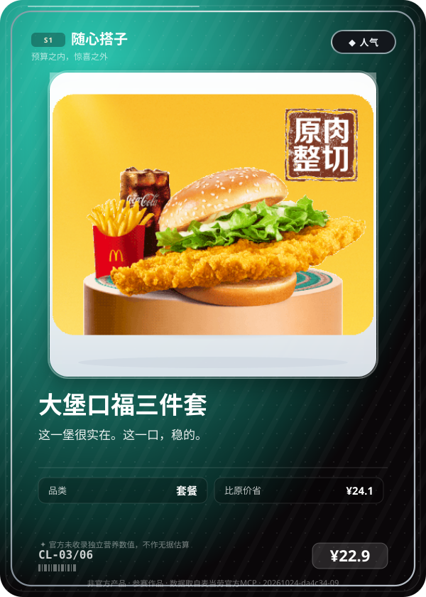</td>
    <td>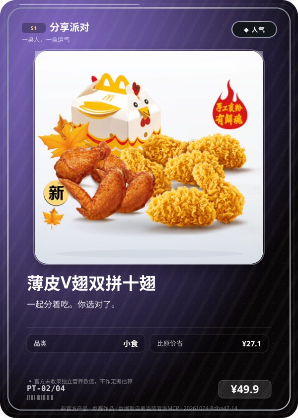</td>
    <td>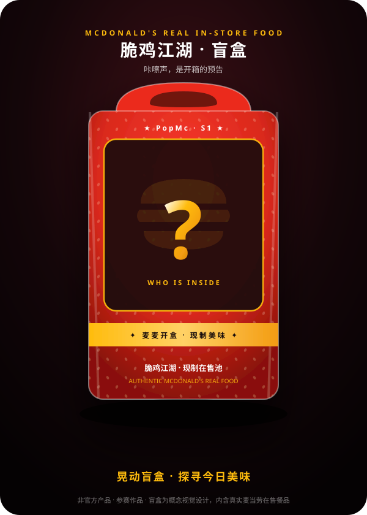</td>
  </tr>
</table>

### 9 大盲盒系列矩阵

| 系列代码 | 系列名称 | 主题与品类 | 图腾款 (SSR) | 场景与情绪映射 |
|---|---|---|---|---|
| `BU` | **牛堡宇宙** | 纯正 100% 牛肉与经典传世汉堡 | 巨无霸 (¥25.5) | 超饿、扎实、能量告急、想吃牛肉 |
| `CH` | **脆鸡江湖** | 国民炸鸡、多汁烤鸡与经典麦辣汉堡 | 麦辣鸡腿汉堡 (¥22.5) | 想吃肉、重口、无辣不欢、宵夜 |
| `FS` | **金黄薯界** | 麦当劳灵魂现炸薯条与解馋小食 | 经典大薯条 (¥13.5) | 嘴馋、垫垫肚子、下午小吃 |
| `SD` | **气泡星海** | 冰爽碳酸特饮与麦当劳经典奶昔 | 麦当劳经典奶昔 (¥15.0) | 口渴、解腻、想喝快乐水、冰爽 |
| `SW` | **甜品星球** | 麦旋风、香芋派与低门槛治愈甜筒 | 圆筒冰淇淋 (¥5.0) | 难过、想被哄、吃糖回血、下午茶 |
| `CF` | **麦咖啡星系** | 现磨浓缩、奶铁与打工人续命咖啡 | 麦咖啡™奶铁 (¥13.9) | 困倦、提神、第二条供电线、清醒 |
| `CL` | **随心搭子** | 预算友好、白月光超值随心配 1+1 | 人气经典随心配 (¥14.9) | 省钱、穷鬼套餐、月底吃土、高性价比 |
| `PT` | **分享派对** | 组局开黑、小食拼盘与多人大分享餐 | BFF 四宫格小食盘 (¥39.8) | 周五晚上、开黑、朋友聚会、放假 |
| `AM` | **晨光早餐** | 05:00-10:30 时段限定麦满分家族 | 猪柳蛋麦满分 (¥16.0) | 早晨、赶时间、十点半前元气唤醒 |

---

## ⚡ 极速开盒：真实对话示例

麦泡泡遵循 **Fast-Path 零等待机制**，首轮绝不向用户反问盘问，一句话直接秒出结果：

```markdown
👤 用户：加班好累，30 块以内随便来个盲盒
🤖 麦泡泡：
正在摇匀本店 132 个美味可能… 开！

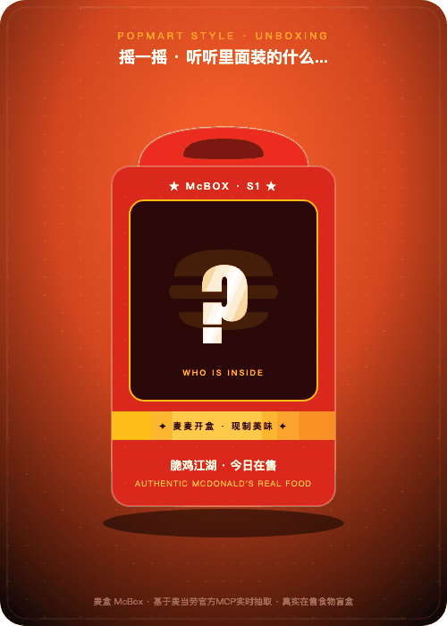

### 🍗【脆鸡江湖 · 当期】龙焰鸡腿堡 · ¥15.9
> 韩式辣椒黄油风味。赶上了，就是你的。
- **官方营养**：510 kcal ｜ 蛋白质 24g ｜ 脂肪 22g
- **门店现价**：¥15.9 (单品实价 · 比原价省 ¥8.1)

👉 **就它了，要下单吗？**
*(默认基于当前门店·到店自取，如需换店、换系列或改外送随时告诉我)*
```

```markdown
👤 用户：我不想选了，给我凑一顿，45 块以内
🤖 麦泡泡：
给你凑好了一整盒！主食+小食+饮料一次满足：


### 🍱【端盒组合】板烧鸡腿堡 + 经典大薯条 + 可口可乐
- **整盒总计**：¥46.5 (预算 ¥50 内锁定 · 单品现价累加)
- **官方热量**：929 kcal (3/3 项有官方数据覆盖)

👉 **三件齐了，要直接下单吗？**
```

---

## 🕹️ 核心创新与技术机制

### 1. 泡泡玛特级 3D 沉浸式开箱动效
- **3D 陀螺仪微动**：鼠标移动时，盲盒随视角产生物理 3D 空间倾斜（Gyro Tilt Effect）；
- **真实开盒仪式**：物理晃盒颠簸 ➔ 撕裂外卖锯齿封条 ➔ 盒顶掀开 ➔ 红金粒子彩屑喷发（Confetti Cannon）➔ 卡牌 360 度翻转飞升定格；
- **纯代码 Web Audio 合成音效**：摇盒骨碌碌碰撞声、撕纸爆裂声、揭晓胜利大三和弦光环音，**零外部音频 MP3 文件依赖**！
- 在线体验：直接在浏览器打开 [`docs/unboxing-player.html`](docs/unboxing-player.html) 即可亲自拆盒。

### 2. 端盒模式（Box Set）：主食 + 小食 + 饮料
- 针对“想吃饱、不想单点”的场景，自动组装一餐；
- **绝不超预算**：系统为主食预先留足小食与饮品的最低开销；若预算极低，自动优雅降级为 2 件或 1 件，总价恒 ≤ 用户预算；
- **无自造套路折扣**：总价严格为单品现价累加，实价透明。

### 3. 三层物理数据解耦（合规底线）
```text
┌─────────────────────────────────────────────────────────────────┐
│ fact        ← 只能来自 MCP 实际返回（名称、现价、官方CDN图、官方营养），缺失即 null，严禁编造 │
│ experience  ← 只能来自本项目规则与文案模板（系列、稀有度边框、风味标签、趣味文案）      │
│ meta        ← 种子 Hash、池指纹、时间桶、开盒 ID（用于可复现验真）                      │
└─────────────────────────────────────────────────────────────────┘
```

### 4. 约束感知系列调度（Constraint-Aware Routing）
- 彻底根除“低预算误报空池”的业界通病：用户输入低预算（如 ¥10）时，调度器**在选系列前先扫描硬约束下的有效池**，自适应加权命中高性价比美食，绝不误报空池；
- **最小差额自愈诊断**：遇到极端超低预算（如 ¥3）时，自动探测全店起抽绝对底线（如 ¥5.0 圆筒），精准提示“仅差 ¥2 即可解锁圆筒冰淇淋”。

### 5. 确定性验真与真实保底概率公示
- 采用 `HMAC-SHA256(Secret, Date|Nonce|Series|Fingerprint)` 生成种子，同一条件必然得到相同结果，拒绝虚假黑箱；
- 运行 `python3 scripts/draw.py --odds` 即可输出经过 20000 次蒙特卡洛测试的**含保底实测概率**（50 抽必得 SSR 图腾款，实际 SSR 概率由裸权重 1.5% 提升至约 2.8%）。

### 6. 两道门下单安全边界
- **门 1（只读门）**：抽盒展示真实价格，可调用 `calculate-price` 精确算价；
- **门 2（写入门）**：只有用户明确确认下单 + AI 完整复述商品与金额 + 用户二次确认后，才允许调用 `create-order`。抽中绝不等于下单，防误触防诱导。

---

## 🚀 安装与加载

本目录 `skill/popmc` 为标准的自包含 Skill 包，已内置全量图片资产与图鉴清单。

- **WorkBuddy 本地使用**：直接存放在 `~/.workbuddy/skills/popmc` 或项目根目录下的 `skill/popmc`；
- **对话直接触发**：输入“今天吃什么/帮我抽个盲盒/给我凑一顿”即可极速响应！

---

## 🧪 离线运行与自检验证

本项目全流程依赖 Python 3 标准库（生成 GIF 动图时使用 Pillow）。无需任何联网 Token 即可离线体验核心算法：

```bash
cd skill/popmc

# 1. 运行 47 项引擎自检测试
python3 -m unittest discover -s tests

# 2. 查看当前系列真实开盒概率公示（含 50 抽保底实测）
python3 scripts/draw.py --pool fixtures/query_meals.sample.json --series beef-universe --odds

# 3. 模拟端盒抽取（45元预算内搭配一餐）
python3 scripts/draw.py --pool fixtures/query_meals.sample.json --box --budget 45

# 4. 生成一张开盒动画动图 GIF
python3 scripts/animate_unbox.py --card /tmp/my_card.json --out unboxing.gif
```

---

## ⚠️ 免责声明

1. 本项目为参赛作品，由开发者独立设计完成，**非麦当劳官方商业产品**。
2. 餐品名称、价格、图片与营养数据均来自麦当劳官方开放平台 MCP 实时返回，最终以麦当劳官方实际供应为准。
3. 盲盒系列主题、稀有度边框光效与风味文案为本项目原创游戏化设定，**不代表官方发行量、限量或授权发售**。
4. 本项目仅供用餐选择与娱乐探索参考，不构成营养或医疗建议。
